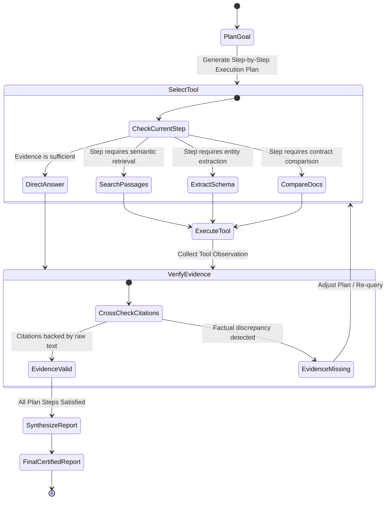

# Autonomous Agent Workflows (LangGraph)

## 1. Overview

The autonomous agent is implemented using **LangGraph** (`backend/app/agents/workflow.py`). It executes structured multi-step reasoning, tool dispatch, evidence cross-checking, and report synthesis with full execution state persistence in PostgreSQL.



---

## 2. Agent State Specification (`backend/app/agents/state.py`)

The agent graph maintains a strongly typed `AgentState` dictionary across all node transitions:

```python
class AgentState(TypedDict):
    run_id: str                      # Unique UUID for the execution trace
    goal: str                        # User's high-level document analysis directive
    plan: List[str]                  # Sequence of planned sub-goals
    current_step_index: int          # Active step pointer
    retrieved_evidence: List[Dict]   # Verified chunks gathered across tools
    extracted_data: Dict[str, Any]   # Structured entities extracted
    comparison_results: List[Dict]   # Discrepancies identified
    intermediate_steps: List[Dict]   # Full tool invocation and observation history
    final_report: Optional[str]      # Markdown synthesis with page citations
    is_completed: bool               # Termination flag
    error: Optional[str]             # Error diagnostics if halted
```

---

## 3. Tool Dispatch Suite (`backend/app/agents/tools.py`)

The agent has access to 5 deterministic document intelligence tools:
1. `document_search(query: str, top_k: int = 5)`: Executes hybrid RRF retrieval against the document index.
2. `get_document_metadata(document_id: str)`: Fetches SHA-256 hash, page counts, and parsing telemetry.
3. `extract_document_entities(document_id: str, schema_type: str)`: Extracts Pydantic schema models (`contract`, `invoice`).
4. `compare_documents(doc_id_a: str, doc_id_b: str)`: Audits clauses across two documents for discrepancies.
5. `verify_evidence(claim: str, passage_id: str)`: Confirms whether a stated claim is directly substantiated by raw chunk text.

Every run is committed to the `agent_runs` database table with its complete plan, execution duration, and tool invocation log.
