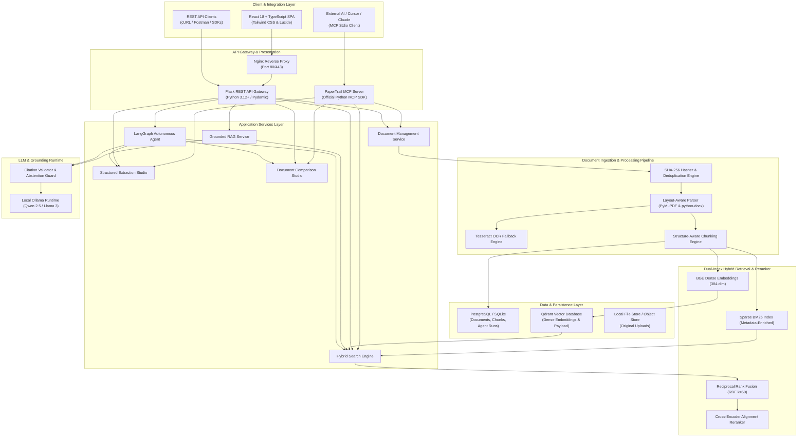

# System Architecture: Evidence-Grounded Document Intelligence

## 1. Architectural Overview

**Evidence-Grounded Document Intelligence** is an enterprise-grade document processing, hybrid retrieval, and autonomous workflow platform engineered for strict factual grounding. Unlike standard retrieval-augmented generation (RAG) wrappers that are prone to hallucinating citations or fabricating details when evidence is sparse, this system implements deterministic layout parsing, dual-index hybrid retrieval, multi-stage cross-encoder reranking, and an algorithmic citation-validation layer that guarantees strict abstention when facts cannot be substantiated.



---

## 2. Component Directory Architecture

```text
evidence-grounded-document-intelligence/
├── backend/
│   ├── app/
│   │   ├── agents/          # LangGraph stateful agent graphs and tools
│   │   ├── api/             # Flask REST endpoints (Auth, Docs, Chat, Search, Agent, Compare, Extract)
│   │   ├── core/            # Database engine, structured logging, JWT security
│   │   ├── evaluation/      # RAG evaluation metrics and benchmark runner
│   │   ├── generation/      # Ollama client, grounded RAG engine, prompt templates
│   │   ├── ingestion/       # Layout parser, OCR fallback, structure-aware chunker, pipeline
│   │   ├── mcp/             # MCP server implementation using official MCP SDK
│   │   ├── models/          # SQLAlchemy ORM models (Document, DocumentChunk, AgentRun)
│   │   ├── retrieval/       # Dense vector store (Qdrant), Sparse BM25, RRF hybrid, CrossEncoder
│   │   ├── schemas/         # Pydantic validation schemas
│   │   ├── services/        # Decoupled business logic services
│   │   ├── utils/           # Cryptographic hashing and formatting
│   │   ├── config.py        # Centralized Pydantic application settings
│   │   └── main.py          # Flask WSGI application factory
│   ├── requirements.txt     # Pinned Python backend dependencies
│   └── tests/               # Pytest test suite (API, Ingestion, Retrieval, Evaluation)
├── frontend/
│   ├── src/
│   │   ├── components/      # Navigation, status badges, layout components
│   │   ├── pages/           # Dashboard, Documents, Search, Chat, Comparison, Extraction, Agent, Evaluation, Settings
│   │   ├── services/        # Axios API client wrapper
│   │   ├── types.ts         # TypeScript interface definitions
│   │   ├── App.tsx          # Root routing and tab state controller
│   │   └── main.tsx         # React 18 DOM mount point
│   ├── package.json         # Frontend dependencies (React, Vite, Lucide, Tailwind)
│   └── vite.config.ts       # Vite build & proxy configuration
├── docs/                    # Deep-dive architecture and technical manuals
│   └── screenshots/         # Verified application screenshots
├── data/
│   ├── sample_documents/    # Multi-format contractual and invoice datasets
│   └── uploads/             # Raw storage directory for uploaded files
├── evaluation/
│   ├── datasets/            # 52-question evaluation dataset
│   ├── reports/             # Generated Markdown evaluation benchmark reports
│   └── results/             # Raw JSON benchmark execution output
├── infrastructure/          # Nginx configuration
├── mcp_server/              # Stdio MCP entry point
├── scripts/                 # Standalone utilities for dataset creation, benchmarking, screenshots
└── docker-compose.yml       # Production multi-container orchestration
```

---

## 3. Data Flow & Execution Boundaries

### 3.1 Synchronous Ingestion Flow
1. **Upload & Hash**: File is received over `multipart/form-data`, validated against the 25 MB limit and allowed extensions (`.pdf`, `.docx`, `.png`, `.jpg`), and hashed with SHA-256.
2. **Deduplication Check**: The database is queried for existing records with the identical hash. If found, ingestion reuses the existing metadata and avoids redundant processing.
3. **Multi-Format Parsing**: PyMuPDF extracts digital text and tables; python-docx extracts Word headings and tables; image files or blank digital pages route to Tesseract OCR.
4. **Structural Chunking**: Chunks are generated while preserving clause section headings, table structures, and page boundaries.
5. **Dual Indexing**:
   - Dense embeddings (384-dimensional BGE model) are indexed into Qdrant.
   - Text and lexical metadata are indexed into an in-memory BM25Okapi instance.
6. **Relational Persistence**: Document status, page count, and chunk metadata are committed to SQLite/PostgreSQL.

### 3.2 Evidence-Grounded Query Flow
1. **Hybrid Retrieval**: Query is simultaneously vectorized and tokenized. Top-15 candidates are fetched from Qdrant (dense) and BM25 (sparse).
2. **Reciprocal Rank Fusion**: Scores are fused using $RRF(d) = \sum_{m} \frac{w_m}{k + r_m(d)}$ ($k=60$).
3. **Cross-Encoder Reranking**: Candidates are rescored using exact lexical overlap, phrase alignment, heading relevance, and document name matching.
4. **Confidence Thresholding**: If the top candidate relevance score falls below `MIN_CITATION_CONFIDENCE` ($0.05$), the engine immediately halts and returns an abstention message.
5. **Context Assembly**: Top-$k$ verified passages are formatted into structured citations: `[Passage N] (Document: doc, Page: P, Section: S)`.
6. **Strict Generation**: The LLM generates the response with explicit `[Citation: N]` references.
7. **Citation Verification**: Every citation tag is regex-parsed and cross-checked against retrieved source chunks. Unsupported citations are stripped.
