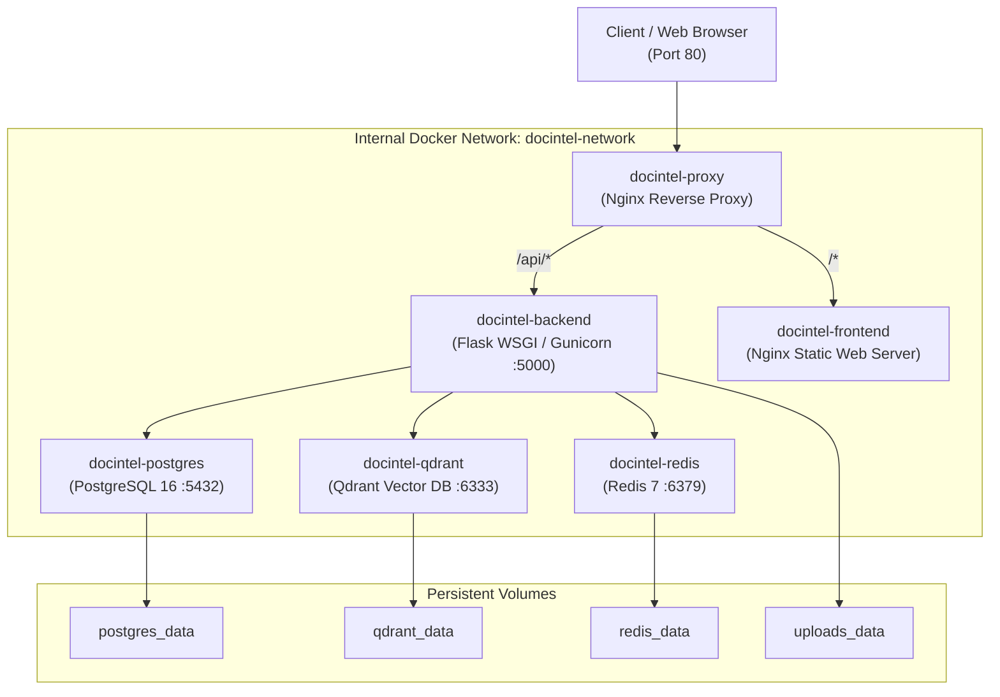

# Deployment & Container Architecture

## 1. Multi-Container Orchestration

The application is orchestrated using Docker Compose (`docker-compose.yml`), managing 5 production services connected across an isolated internal bridge network (`docintel-network`):



---

## 2. Docker Compose Specification (`docker-compose.yml`)

- **Reverse Proxy**: Nginx routing `/api/*` to the Flask backend and other paths to the React SPA with client-side history API fallback (`try_files $uri /index.html`).
- **Backend Service**: Python 3.12-slim base image with Tesseract OCR, PyMuPDF, and SQLAlchemy dependencies pre-compiled.
- **Relational Storage**: PostgreSQL 16 Alpine with health checks (`pg_isready`).
- **Vector Storage**: Qdrant official release with persistence in `/qdrant/storage`.
- **Cache**: Redis 7 Alpine with persistent append-only file (AOF) storage.

---

## 3. Deployment Commands

### 3.1 Launch Complete Stack
```bash
docker compose up -d --build
```

### 3.2 Verify Container Health
```bash
docker compose ps
```

### 3.3 Inspect Logs
```bash
docker compose logs -f docintel-backend
```

### 3.4 Teardown
```bash
docker compose down -v
```
