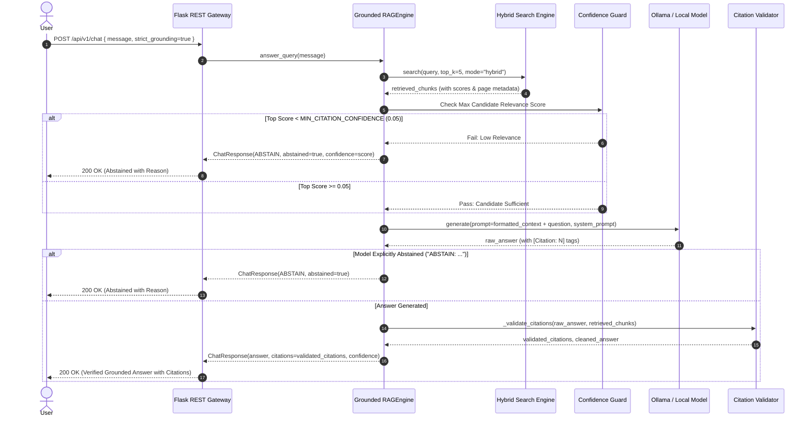

# Evidence-Grounded Generation & Citation Verification

## 1. Overview

The generation engine enforces strict factual attribution. Answers are generated exclusively from retrieved document chunks, every claim must carry an auditable citation tag, and the engine automatically abstains when evidence is missing or insufficient.



---

## 2. Citation Verification Specification

### 2.1 Prompt Instructions (`backend/app/generation/prompts.py`)
The system prompt strictly commands the LLM:
1. Every claim, number, date, and fact MUST be directly supported by a source passage.
2. For every factual claim, cite the source using: `[Citation: <N>]` where `<N>` corresponds to the passage number.
3. If the retrieved passages do NOT contain sufficient factual evidence to answer with certainty, state:
   *"ABSTAIN: The provided document evidence does not contain sufficient factual support to answer this inquiry."*
4. Never extrapolate, assume, or invent details not explicitly written in the passages.

### 2.2 Algorithmic Verification (`backend/app/generation/grounder.py`)
The validator regex matches citations across common LLM output formats:
```python
citation_tags = re.findall(r"\[(?:Citation|Passage)?\s*:?\s*(\d+)\]", answer, re.IGNORECASE)
```
For each matched tag:
- The 0-based index `idx = tag - 1` is validated against `0 <= idx < len(retrieved_chunks)`.
- If valid, a `Citation` object is created with page number, document name, source excerpt, relevance score, and status `"verified"`.
- If an answer claims facts but cites invalid passages, the system flags the citation as unverified and enforces grounding confidence reduction.

### 2.3 Verified Citation Schema (`backend/app/schemas/chat.py`)
```typescript
interface Citation {
  citation_id: number;
  document_id: string;
  document_name: string;
  page_number: number;
  source_passage: string;
  relevance_score: number;
  evidence_status: "verified" | "unverified";
}
```
