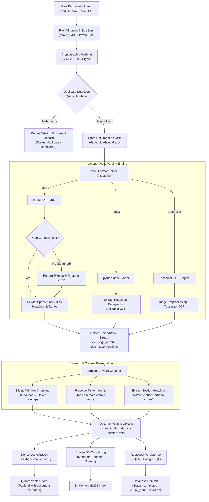

# Document Ingestion & Processing Pipeline

## 1. Pipeline Overview

The document ingestion pipeline transforms heterogeneous enterprise documents into structured, search-optimized, layout-aware chunks with full provenance tracking.



---

## 2. Core Implementation Modules

### 2.1 Cryptographic Hash & Deduplication (`backend/app/utils/hashing.py`)
Computes SHA-256 in 64 KB streaming chunks to process large documents without exhausting memory:
```python
def compute_sha256(file_path: str) -> str:
    hasher = hashlib.sha256()
    with open(file_path, "rb") as f:
        while chunk := f.read(65536):
            hasher.update(chunk)
    return hasher.hexdigest()
```

### 2.2 Layout-Aware Multi-Format Parsing (`backend/app/ingestion/parser.py`)
- **PDF Extraction**: Uses PyMuPDF (`fitz`) `page.get_text("dict")` to extract text blocks, span font sizes, and structural layout. It detects clause headings based on font size thresholds and regex patterns (`SECTION <N>`, `ARTICLE <N>`, `INVOICE`, `SCHEDULE`).
- **Table Preservation**: Identifies tabular data via PyMuPDF table finder (`page.find_tables()`), serializing table rows into formatted markdown blocks to maintain row-column alignment.
- **Scanned Fallback**: If a PDF page contains no digital text layer, the parser automatically renders the page pixmap to an image and triggers the Tesseract OCR fallback.
- **DOCX Extraction**: Uses `python-docx` to iterate through paragraphs and tables, preserving Word heading hierarchies (`Heading 1`, `Heading 2`).

### 2.3 Structure-Aware Chunking (`backend/app/ingestion/chunker.py`)
- **Atomic Tables**: Tables are preserved as complete atomic chunks rather than arbitrarily split across sliding windows, preventing broken financial or legal tabular records.
- **Heading Context Inheritance**: Chunks inherit their parent clause heading (e.g. `SECTION 2: FEES AND PAYMENT TERMS`), which is later leveraged by both the BM25 index and cross-encoder reranker.
- **Windowing Parameters**: Default chunk size of 500 words with 75-word overlap (`CHUNK_SIZE=500`, `CHUNK_OVERLAP=75`).

---

## 3. Ingestion Error Handling & Resilience
- **File Validation**: Rejects files exceeding 25 MB (`413 Payload Too Large`) or with unapproved extensions.
- **Transactional Rollback**: Database records and vector upserts are managed within rollback-safe exception blocks; failures log the exact traceback and set `processing_status = 'failed'`.
- **Deduplication Speedup**: Duplicate uploads complete in under 5 ms without re-parsing or re-embedding.
