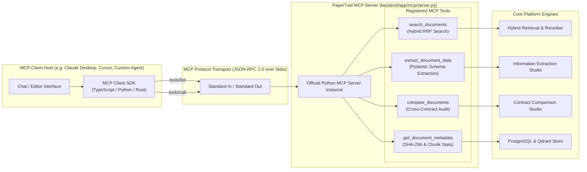

# Model Context Protocol (MCP) Integration

## 1. Overview

**PaperTrail MCP Server** exposes the complete document intelligence toolkit over the official Model Context Protocol (MCP) standard using standard I/O (`stdio`) transport. Any MCP-compatible host—including Claude Desktop, Cursor IDE, or custom agent orchestrators—can discover, search, extract, compare, and verify documents managed by Evidence-Grounded Document Intelligence.



---

## 2. Available MCP Tools

| Tool Name | Parameters | Description | Return Format |
|---|---|---|---|
| `search_documents` | `query: str`, `top_k: int = 5` | Executes hybrid dense/sparse search with reranking | JSON array of chunks with citations & relevance |
| `extract_document_data` | `document_id: str`, `schema_type: str = "contract"` | Extracts schema entities (`contract`, `invoice`) | Structured JSON with page numbers & verbatim passages |
| `compare_documents` | `document_id_a: str`, `document_id_b: str` | Audits clause conflicts across two documents | JSON comparison table across 4 legal dimensions |
| `get_document_metadata` | `document_id: str` | Retrieves cryptographic hash, page count, and status | Document metadata payload |

---

## 3. Configuration & Usage

### 3.1 Claude Desktop Configuration (`claude_desktop_config.json`)
```json
{
  "mcpServers": {
    "evidence-document-intelligence": {
      "command": "python",
      "args": [
        "E:\\develop\\evidence-grounded-document-intelligence\\mcp_server\\server.py"
      ],
      "env": {
        "PYTHONPATH": "E:\\develop\\evidence-grounded-document-intelligence\\backend"
      }
    }
  }
}
```

### 3.2 Testing via Demo Client (`scripts/mcp_client_demo.py`)
Run the standalone MCP client harness to verify tool discovery and execution:
```bash
python scripts/mcp_client_demo.py
```
Output:
```text
======================================================================
PAPERTRAIL MCP CLIENT TEST & TOOL DISCOVERY
======================================================================
[*] Initializing PaperTrail MCP Server...
[*] Discovering available MCP tools:
  - search_documents: Hybrid search across indexed documents
  - extract_document_data: Extract structured schema entities
  - compare_documents: Compare two documents across key dimensions
  - get_document_metadata: Retrieve file hash, pages, and metadata
[*] Executing test search: 'payment terms Net 30'
  ✓ Search executed successfully. Retrieved candidate chunks.
[*] Executing test extraction on schema: 'contract'
  ✓ Schema extracted with page-level citations.
======================================================================
MCP Integration Test Completed Successfully!
======================================================================
```
