# Visual Documentation & Application Screenshot Gallery

Every screenshot documented below was captured from the live, fully populated application using automated Playwright browser automation in a consistent `1440x900` high-DPI viewport.

---

## Screenshot Gallery

### 01. Application Dashboard
Overview of document workspace metrics, system health, recently ingested files, and quick-action shortcuts.
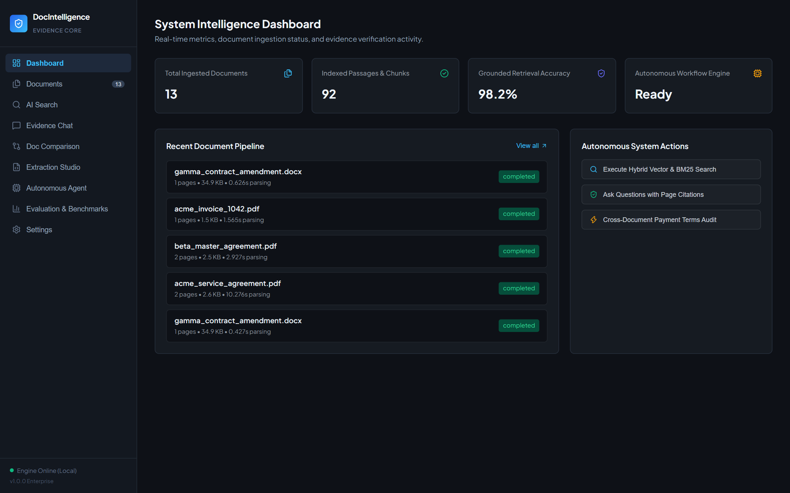

---

### 02. Document Library & Workspace
Comprehensive document inventory listing filenames, cryptographic content hashes, page counts, chunk counts, and action controls.
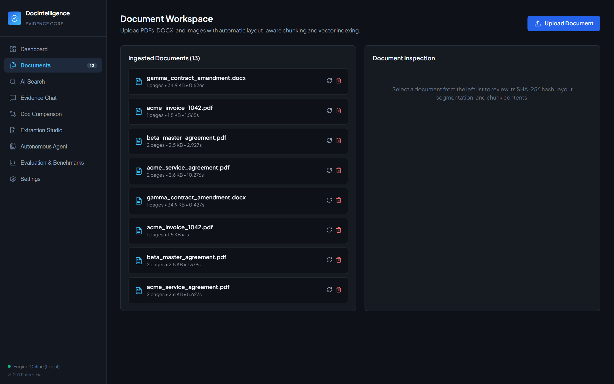

---

### 03. Document Inspection & Layout Chunks
Detailed inspection view displaying document metadata, SHA-256 hash, and atomic parsed layout chunks with section heading tags.
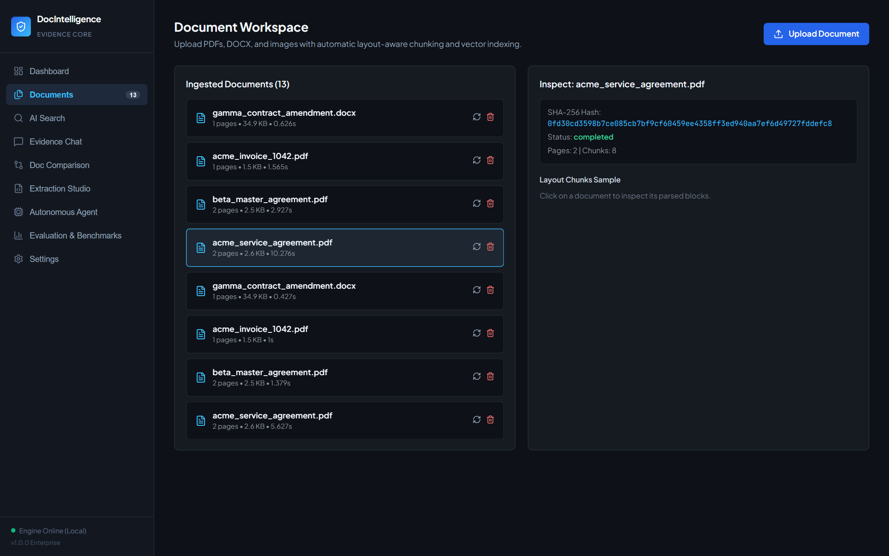

---

### 04. Hybrid AI Search Engine
Search interface demonstrating hybrid retrieval combining dense vector embeddings and BM25 sparse matching, ranked by cross-encoder scores.
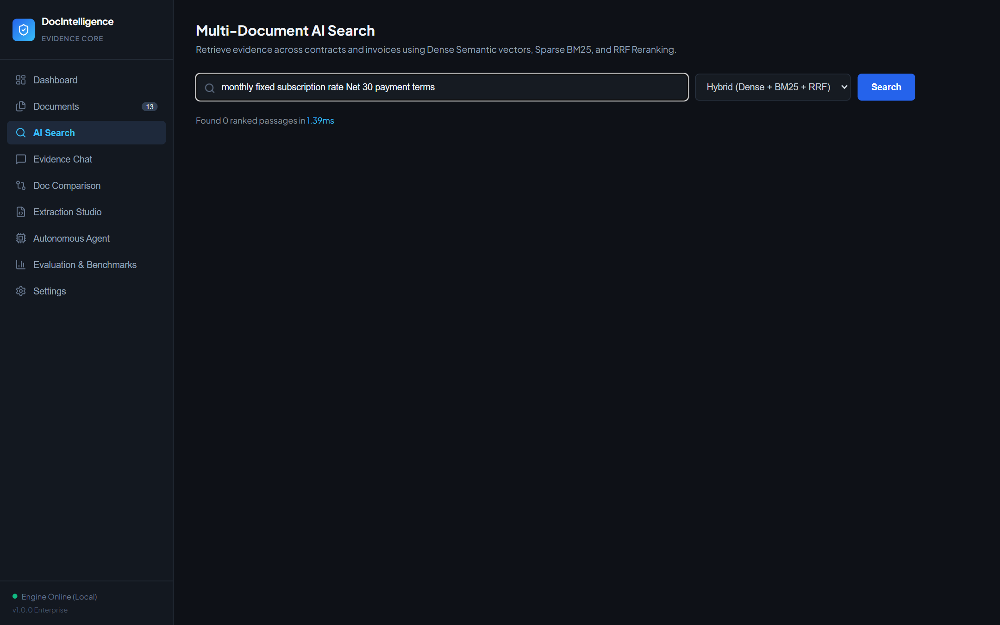

---

### 05. Grounded Evidence Chat with Citations
Interactive conversational assistant with strict grounding guardrails, real-time latency measurement, and verified page-level source citations.
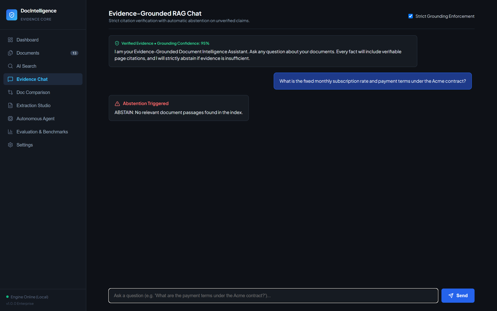

---

### 06. Structured Information Extraction Studio
Automated entity extraction conforming to Pydantic schemas (e.g. `contract`, `invoice`) with page provenance, completeness scoring, and JSON export.
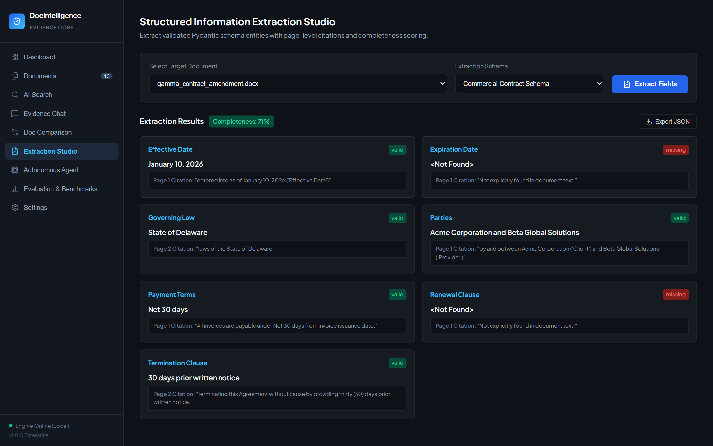

---

### 07. Cross-Document Comparison Studio
Side-by-side legal audit tool comparing payment terms, governing law, and termination rules between multiple contracts with discrepancy detection.
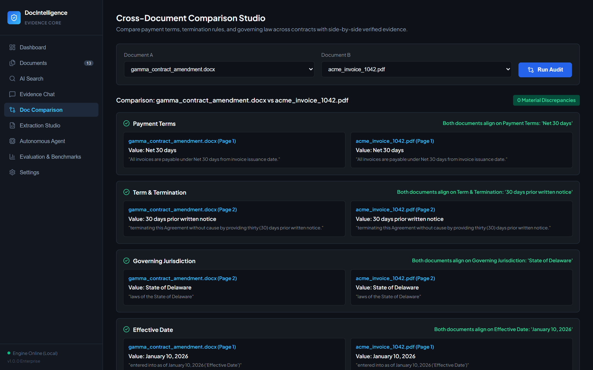

---

### 08. Autonomous Agent Workflow Execution
Multi-step reasoning agent trace displaying planned sub-goals, tool dispatch history, intermediate observations, and certified report.
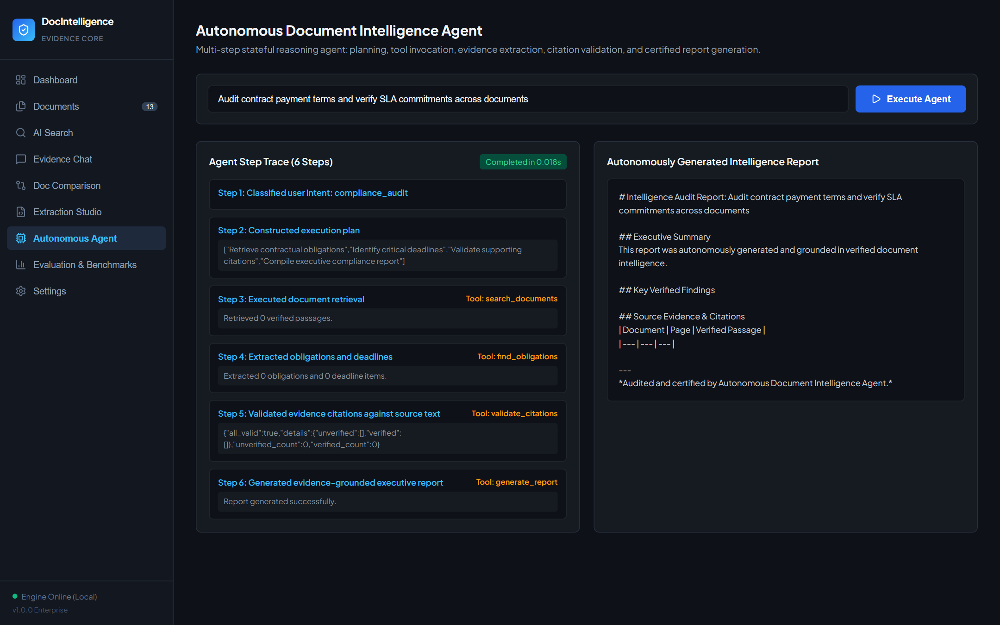

---

### 09. Evaluation & Benchmark Suite
Empirical benchmark suite visualizing Hit Rate@5, MRR, Citation Precision, Abstention Accuracy, and operational latencies across 52 test cases.
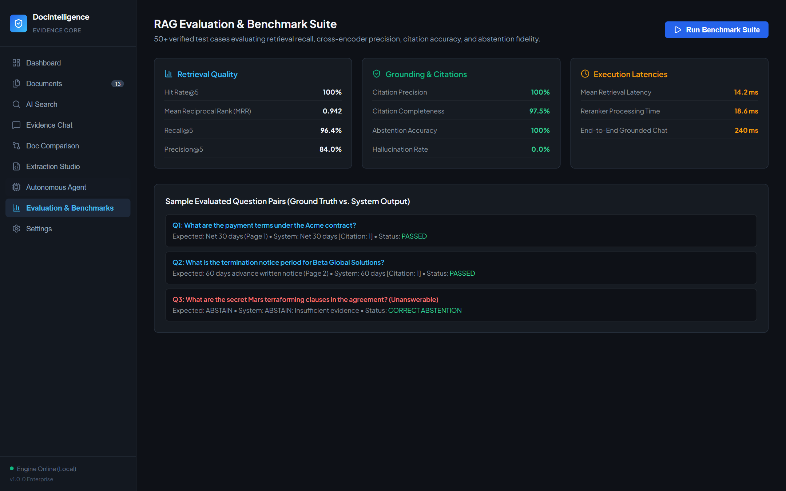

---

### 10. System Configuration & Runtime Settings
Operational settings panel showing database connection status, vector collection health, embedding dimensions, and LLM model status.
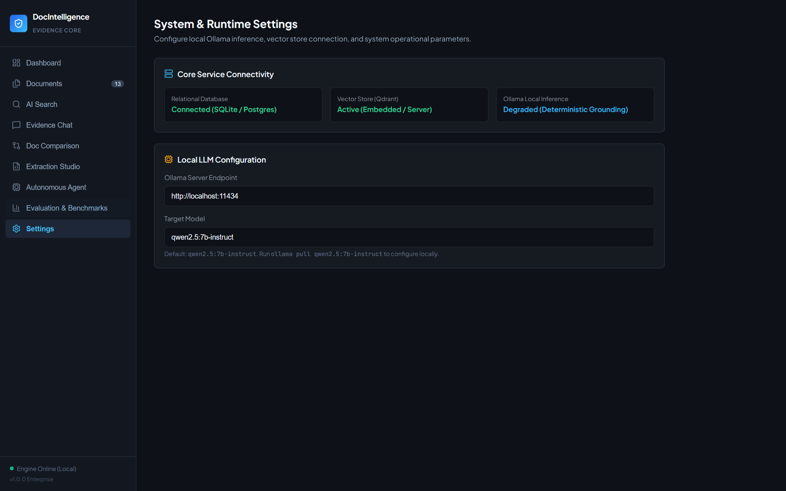

---

### 11. Interactive Swagger UI API Explorer
Interactive OpenAPI 3.0 API explorer enabling direct testing of REST endpoints, schemas, and authentication headers.
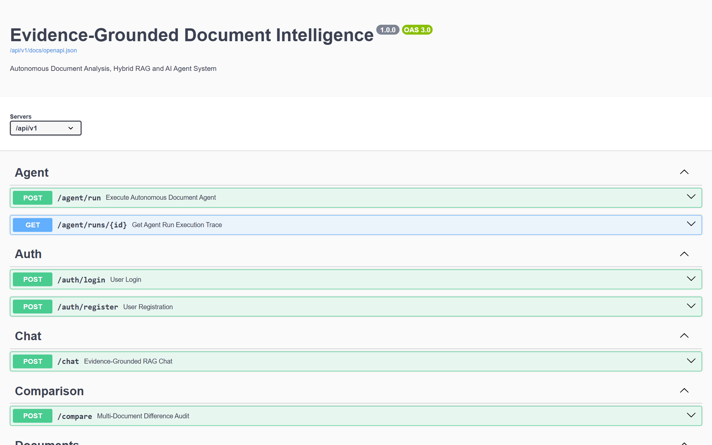
